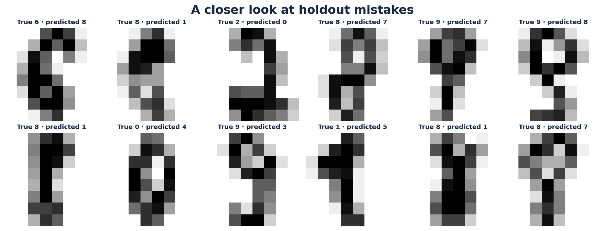
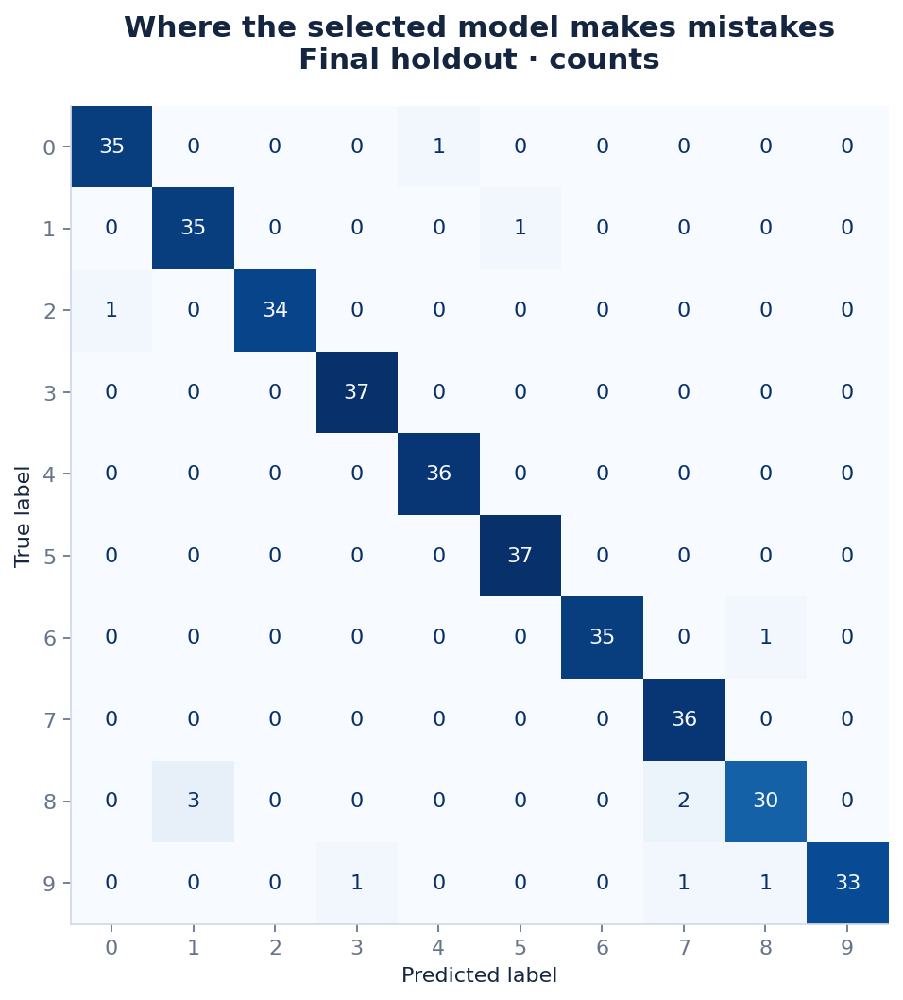
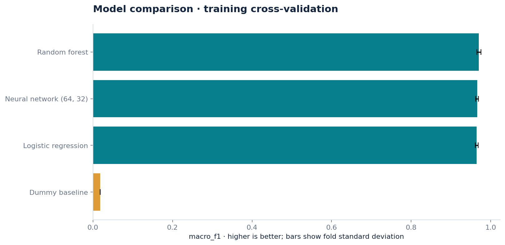
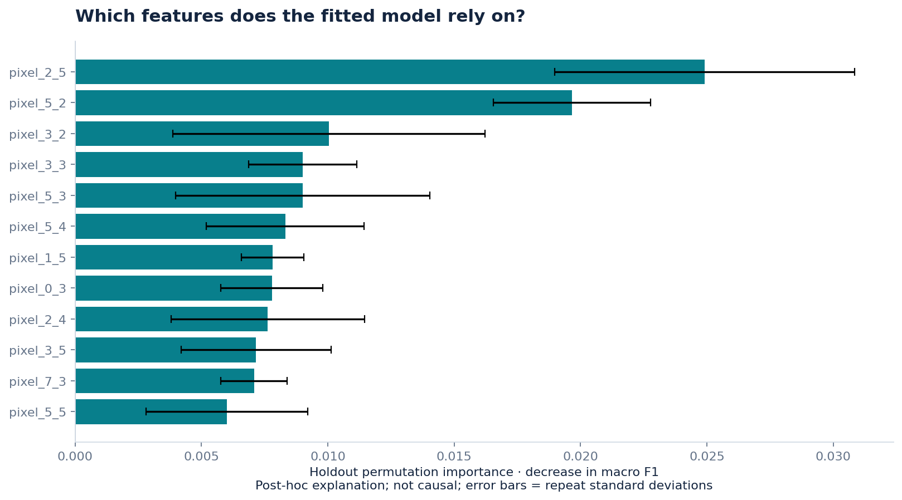
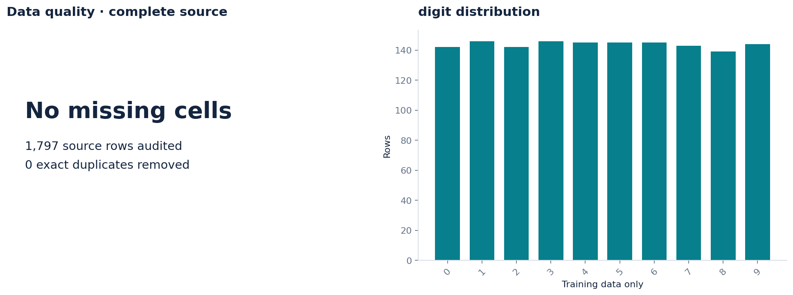
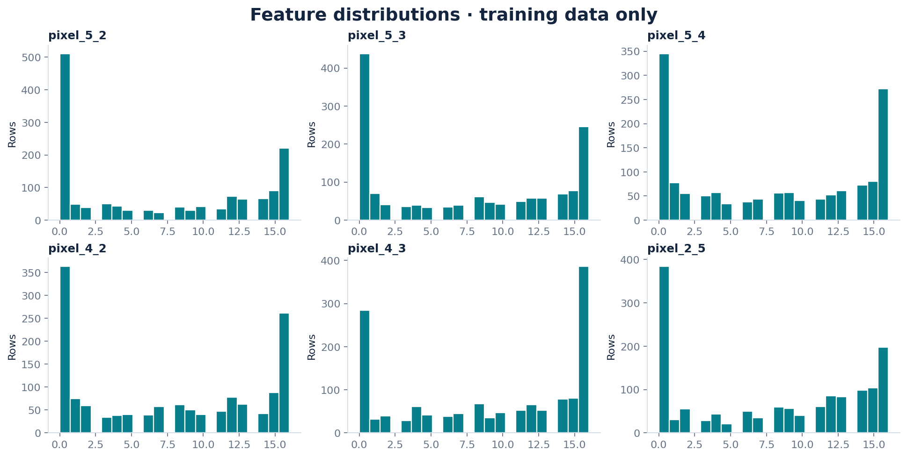

# Handwritten Digits Classification

Multi-class classification benchmark evaluating machine learning models on the 8x8 optical handwritten digits dataset.

---

## Overview

* **Task:** Multi-class classification across 10 handwritten digits (0–9) using normalized pixel intensities.
* **Dataset:** 1,797 grayscale samples ($8 \times 8$ resolution, 64 candidate features).
* **Selected Model:** **Random Forest** (Holdout Macro F1 = 0.9661, Accuracy = 96.67%).
* **Baseline Comparison:** Dummy baseline achieved Macro F1 = 0.0182 and Accuracy = 10.00%.

---

## Key Results

Random Forest emerged as the top-performing model across stratified cross-validation and holdout splits.

### Cross-Validation Performance (Stratified)

| Model | Macro F1 | Fold SD |
| :--- | :--- | :--- |
| **Random Forest** | **0.9700** | 0.0050 |
| Neural Network (64, 32) | 0.9656 | 0.0036 |
| Logistic Regression | 0.9644 | 0.0035 |
| Dummy Baseline | 0.0183 | 0.0002 |

### Holdout Evaluation (360 Samples)

| Model | Accuracy | Macro F1 | Balanced Accuracy |
| :--- | :--- | :--- | :--- |
| **Random Forest** | **96.67%** | **0.9661** | **0.9662** |
| Dummy Baseline | 10.00% | 0.0182 | 0.1000 |

> **95% Bootstrap CI for Macro F1:** 0.9438 – 0.9805 (200 stratified resamples).

---

## Data Summary

* **Source:** [UCI Optical Recognition of Handwritten Digits](https://archive.ics.uci.edu/dataset/80/optical+recognition+of+handwritten+digits) (CC BY 4.0)
* **Quality Check:** 1,797 samples, 64 features, 0 missing cells, 0 duplicates.
* **Feature Importance:** `pixel_2_5` showed the largest mean permutation score drop (0.0249).

---

## Visualizations

| Sample Predictions | Confusion Matrix |
| :---: | :---: |
|  |  |

| Model Comparison | Feature Importance |
| :---: | :---: |
|  |  |

| Data Quality & Target Distribution | Feature Distributions |
| :---: | :---: |
|  |  |

---

## Repository Structure

```text
├── figures/                 # Confusion matrix, sample predictions, and diagnostic plots
├── analysis.ipynb           # Walkthrough of model training and error inspection
├── audit.json               # Pipeline environment specifications and data hashes
├── data_dictionary.csv      # Feature map detailing pixel coordinates
├── descriptive_statistics.csv # Summary distribution stats across all 64 pixels
├── error_analysis.csv       # Predictions, ground truths, and holdout misclassifications
├── feature_importance.csv   # Permutation importance rankings
├── metrics.json             # Stratified CV and final holdout metric scores
└── README.md
